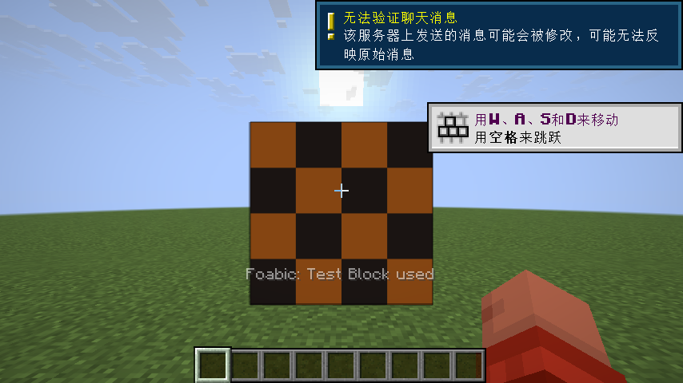

# Foabic Beta 0.2

**A small Fabric-hosted mod API for Minecraft 26.1.**

Foabic 0.2 is deliberately narrow: a Fabric adapter, a typed registry bridge, `submit`, `connect`, and one concrete `UseBlockSignal`. It is not a platform, not a cross-platform abstraction, and not a Mixin framework.



The screenshot is from an actual Fabric 26.1 client connected to a Fabric 26.1 server: a Foabic mod registered `smoketest:test_block`, the client received it and its assets, right-clicking it fired `UseBlockSignal`, and the action bar shows **“Foabic: Test Block used”**.

## Beta 0.2 scope

Included:

- Fabric Loader 0.20.1 / Fabric API 0.145.1+26.1 adapter
- Common client/server initialization for registry parity
- `ModContext.submit(Registry<T>, id, value)` content registration
- `ModContext.connect(Class<S>, Consumer<S>)` signal subscription
- `UseBlockSignal` with mutable `Result`
- Typed registry views in `FabricRegistries`
- Server events: lifecycle, tick, level tick, player join/leave
- Commands, tick scheduler, config, scoped resources
- One runnable example mod and a client/server verification harness

**Explicitly not in Beta 0.2** (all deferred to Beta 0.3+):

- NeoForge adapter
- A signal standard library
- A Gradle/Maven build plugin
- Mixin support
- Cross-platform packaging or abstraction
- Block-model generation, creative-tab helpers, networking, GUI APIs

The point of 0.2 is that the thin path works end to end.

## Artifacts

```text
dist/foabic-api-0.2.0.jar                 46.6 KiB   compile-time API
dist/foabic-fabric-0.2.0.jar              92.9 KiB   Fabric mod (API + loader + adapter)
dist/foabic-example-smoketest-0.2.0.jar    7.5 KiB   runnable block/signal example
```

No runtime dependency is bundled beyond the JDK and Fabric API.

## Repository layout

```text
src/api/java         dev.foabic.api.*      public API, no Minecraft or Fabric classes
src/loader/java      dev.foabic.loader.*   discovery, dependencies, events, commands, scheduler
src/fabric/java      dev.foabic.fabric.*   Fabric Loader/API adapter, registry bridge, signals
src/fabric/resources/fabric.mod.json       Fabric metadata of the adapter jar
src/test/java        dev.foabic.test.*     plain-Java test suite, no JUnit
examples/smoketest   runnable block + signal example
examples/client-test manual client verification harness (not a user mod)
docs/                API, Fabric adapter, verification, roadmap
dist/                built jars committed with this beta
```

## Install

Prerequisites:

- Java 25
- Fabric Loader 0.20.1 for Minecraft 26.1
- Fabric API 0.145.1+26.1

Place in the Fabric server's `mods/`:

```text
mods/
  fabric-api-0.145.1+26.1.jar
  foabic-fabric-0.2.0.jar
  foabic-example-smoketest-0.2.0.jar
```

Place the same three jars in the Fabric client's `mods/`. Foabic initializes content mods on both sides so Fabric registry sync sees identical block/item IDs.

Pure logic-only Foabic mods can instead live in `foabic-mods/`. A mod that ships `assets/` must also be visible to Fabric as a resource-bearing mod; the example does this with an entrypoint-free `fabric.mod.json` in addition to `foabic.mod`.

## The example mod

The example is a normal Fabric resource mod plus Foabic logic:

- `foabic.mod` is read by Foabic.
- `fabric.mod.json` has **no entrypoint**. Fabric only needs it to expose the jar's `assets/` as a built-in resource pack.
- Foabic scans both `foabic-mods/` and Fabric's `mods/` for `foabic.mod`.

It registers a block and a block item:

```java
ResourceLocation id = ResourceLocation.of("smoketest", "test_block");
Identifier mcId = Identifier.fromNamespaceAndPath(id.namespace(), id.path());
ResourceKey<Block> key = ResourceKey.create(Registries.BLOCK, mcId);

Block block = new Block(BlockBehaviour.Properties.of()
        .setId(key)
        .strength(1.0F));

context.submit(FabricRegistries.BLOCKS, id, block);
```

It listens to the one signal:

```java
context.connect(UseBlockSignal.class, signal -> {
    signal.player().sendActionBar("Foabic: Test Block used");
    signal.setResult(UseBlockSignal.Result.SUCCESS);
});
```

On player join, the example places the block two blocks east and one block up. A real Fabric client right-clicks it; the rendered block and action bar are visible in the screenshot above. The same server-side path can be exercised with `/foabictest use`, which uses a Fabric `FakePlayer` and prints `FOABIC_USE_RESULT=Success[...]`.

## Registry

`FabricRegistries` exposes typed views over Minecraft's built-in registries:

```java
FabricRegistries.BLOCKS
FabricRegistries.ITEMS
FabricRegistries.ENTITY_TYPES
FabricRegistries.SOUND_EVENTS
FabricRegistries.PARTICLE_TYPES
FabricRegistries.BLOCK_ENTITY_TYPES
```

`submit` delegates to the generic `Registry<T>` interface. Registration must happen before Minecraft freezes the registry; the adapter reports a clear `RegistryException` if it is too late.

## Build

Windows, JDK 25, official Minecraft 26.1 server jar, Fabric Loader and Fabric API jars:

```bat
build.cmd ^
  -JavaHome "C:\path\to\jdk-25" ^
  -McJar "C:\path\to\server.jar" ^
  -FabricLoaderJar "C:\path\to\fabric-loader-0.20.1.jar" ^
  -FabricApiJar "C:\path\to\fabric-api-0.145.1+26.1.jar"
```

The build script:

1. extracts the nested server jar and libraries;
2. extracts Fabric API's nested modules;
3. compiles API, loader and Fabric adapter;
4. packages the Fabric mod and the example;
5. runs the core tests.

`build.cmd` bypasses the execution policy for the PowerShell script.

## Test evidence

- Fabric 26.1 server: block/item registered, `submit` and registry lookups succeeded.
- Fabric 26.1 client: registry sync succeeded, block rendered with its blockstate/model/texture, right-click reached the server.
- Server log: `FOABIC_USE_SIGNAL block=smoketest:test_block ...`.
- Client action bar: `Foabic: Test Block used`.
- Screenshot: [docs/images/foabic-client.png](docs/images/foabic-client.png).
- Core tests: versions, events, scheduler, commands.

Details: [docs/VERIFICATION.md](docs/VERIFICATION.md).

## API and scope docs

- [docs/API.md](docs/API.md)
- [docs/FABRIC.md](docs/FABRIC.md)
- [docs/VERIFICATION.md](docs/VERIFICATION.md)
- [docs/ROADMAP.md](docs/ROADMAP.md)

## Status

`0.2.0` is a Beta preview for Minecraft **26.1** and Fabric. It is not binary-compatible across 0.x. Do not add NeoForge, a signal library, Mixin, or a build plugin to this branch; they belong to 0.3+.

## Contributing

See [CONTRIBUTING.md](CONTRIBUTING.md), [CODE_OF_CONDUCT.md](CODE_OF_CONDUCT.md) and the build notes above. Report security issues privately via [SECURITY.md](SECURITY.md), not in a public issue.

## Disclaimer

Foabic is an independent third-party project, not affiliated with or endorsed by Mojang Studios, Microsoft or the Fabric project. "Minecraft" is a trademark of Mojang Studios. This repository contains no Minecraft game files and does not redistribute Fabric Loader or Fabric API; obtain those yourself.

## License

MIT. See [LICENSE](LICENSE).
