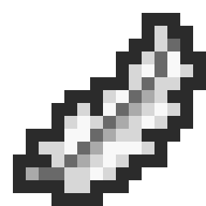

# Foabic 1.2



**A small, platform-neutral mod API for Minecraft 26.3, with real Fabric and NeoForge adapters and a dual-jar Gradle plugin.**

Foabic 1.2 hardens the runtime and turns the two-platform setup into a build tool:

- **Lifecycle-safe signals.** `connect` returns a `FoabicSubscription`; `unsubscribe()` removes a listener immediately, and both adapters clear the session bus when the server stops.
- **Registry freeze guard.** A late `submit` throws `FoabicRegistryFrozenException` with a clear, actionable `ERROR` instead of a low-level registry crash.
- **A genuinely tiny core.** `foabic-api-1.2.0.jar` is **14,420 bytes** (< 15 KiB) and contains **no** `net.fabricmc.*` or `net.neoforged.*` import.
- **Foabic Loom.** One source tree, one `foabic.mod.json`, one `gradlew build`, and `dist/mod-fabric.jar` + `dist/mod-neoforge.jar`.
- **Networking.** `FoabicPacket` + `NetworkManager.sendToServer` / `sendToClient`, backed by Fabric's play payload registry and NeoForge 26.3's `RegisterPayloadHandlersEvent`.
- **Config.** `context.config().register(MyConfig.class)` reads or creates a pretty-printed JSON file; records and ordinary POJOs are supported.
- **Mod metadata icons.** Drop `icon.png` into `src/main/resources`; Foabic Loom injects it into both platform metadata files. See [launcher support](docs/LAUNCHER_ICONS.md): PCL2 does not read local mod icons.
- **Canonical metadata.** `foabic.mod.json` replaces the old properties file; the legacy file is still accepted for migration.

## Supported matrix

| Component | Version |
| --- | --- |
| Minecraft Java Edition | **26.3** |
| Java | **25** |
| Fabric Loader | **0.20.1** |
| Fabric API | **0.166.2+26.3** |
| NeoForge | **26.3.0.115** |
| Foabic | **1.2.0** |

Only Minecraft 26.3 is supported. There is no cross-version abstraction.

## Artifacts

```text
dist/foabic-api-1.2.0.jar             14,420 B   core API, < 15 KiB, zero MC imports
dist/foabic-content-1.2.0.jar         32,219 B   Minecraft-facing API (signals/registry)
dist/foabic-fabric-1.2.0.jar         124,592 B   Fabric adapter + core + content + loader
dist/foabic-neoforge-1.2.0.jar       124,183 B   NeoForge adapter + core + content + loader
dist/foabic-example-minimal-1.2.0.jar 10,344 B   v1.2 acceptance mod
dist/foabic-example-chat-1.2.0.jar     2,786 B   chat example
```

The platform jars are separate. The core API, content API and loader are bundled into each adapter jar, so a user installs one platform jar, not four. There is no universal/merged jar. `gradlew build` writes `dist/SHA256SUMS`.

`foabic-content` is a separate compile-time artifact only because the 15 KiB core limit forbids putting Minecraft-facing types in the core jar. It is not a fourth runtime install.

## Install

### Fabric

```text
mods/
  fabric-api-0.166.2+26.3.jar
  foabic-fabric-1.2.0.jar

foabic-mods/
  my-foabic-mod.jar
```

### NeoForge

```text
mods/
  foabic-neoforge-1.2.0.jar

foabic-mods/
  my-foabic-mod.jar
```

Foabic mods are loaded by the Foabic loader, not by Fabric or NeoForge's own entrypoint system. They contain `foabic.mod.json`. `mods/` is also scanned as a fallback, but `foabic-mods/` is preferred.

The adapter must be present on both client and server for a client connection, because content registration runs on both logical sides.

## A 1.2 mod

```java
public final class MyMod implements ModInitializer {
    @Override
    public void onInitialize(ModContext context) {
        MyConfig config = context.config().register(MyConfig.class);

        NetworkManager.register(PingPacket.class, PingPacket::new);

        FoabicSubscription tick = context.connect(ServerTickSignal.class, signal -> {
            if (signal.tick() == 20L) {
                context.logger().log(System.Logger.Level.INFO, "tick 20");
                tick.unsubscribe();
            }
        });
    }
}
```

`src/main/resources/foabic.mod.json`:

```json
{
  "schemaVersion": 1,
  "id": "mymod",
  "version": "1.2.0",
  "name": "My Mod",
  "description": "A small Foabic mod.",
  "authors": ["Me"],
  "license": "MIT",
  "environment": "*",
  "entrypoint": "mymod.MyMod",
  "api": "^1.2.0",
  "icon": "icon.png",
  "texture": "mymod:block/my_block",
  "depends": {
    "foabic": ">=1.2.0"
  }
}
```

`texture` is optional but recommended for generated block assets. The PNG goes to `assets/mymod/textures/block/my_block.png`; Foabic generates the blockstate, block model and item model and installs them as a built-in resource pack.

## Lifecycle and cleanup

```java
FoabicSubscription subscription =
        context.connect(ServerTickSignal.class, signal -> { ... });

subscription.unsubscribe();
```

- `connect` returns `FoabicSubscription`, not a one-way registration.
- `unsubscribe()` is idempotent.
- The Fabric adapter listens to `ServerLifecycleEvents.SERVER_STOPPED`.
- The NeoForge adapter listens to `ServerStoppedEvent`.
- Both call `FoabicInternal.onServerStopped()`, which clears the session event bus. Adapters log `FOABIC_STOP_CLEAN ... tick_listeners=false` after cleanup.
- `EventBus.clear()` also drops the listener callback, so a retained old handle does not keep the mod's listener object reachable.

`EventBus` is synchronous and exact-type. Listeners run on the posting thread; listener exceptions are isolated and reported to the bus error handler. The 1.2 bus has insertion-order dispatch and no priority API.

## Registry freeze guard

The loader opens the registration window before mod initialization. Fabric closes it after `FoabicLoader.load()`; NeoForge closes it at `FMLCommonSetupEvent`, after `RegisterEvent` has flushed the deferred queues.

A late submission produces the required line:

```text
[Foabic] 模组 foabic_test 试图在注册表冻结后注册物品 foabic_test:late_item，已被拦截。
```

and throws `dev.foabic.api.registry.FoabicRegistryFrozenException`. The guard is in both `ModContext.submit` and the `FoabicRegistries` proxy, so a direct late `register` is intercepted too.

## Networking

```java
public final class PingPacket implements FoabicPacket {
    private String text;

    public PingPacket() {
    }

    public PingPacket(String text) {
        this.text = text;
    }

    @Override
    public byte[] encode() {
        return text.getBytes(StandardCharsets.UTF_8);
    }

    @Override
    public void decode(byte[] data) {
        text = new String(data, StandardCharsets.UTF_8);
    }

    @Override
    public void handle() {
        // Runs on the game thread.
    }
}
```

Register once during initialization:

```java
NetworkManager.register(PingPacket.class, PingPacket::new);
```

Send:

```java
NetworkManager.sendToServer(new PingPacket("hello"));
NetworkManager.sendToClient(serverPlayer, new PingPacket("hello"));
```

All packets share the `foabic:packet` play payload and carry the packet class name plus opaque bytes. Fabric uses `PayloadTypeRegistry` + `ServerPlayNetworking`/`ClientPlayNetworking`. NeoForge 26.3 no longer has the old `SimpleChannel`; Foabic uses its supported replacement, `RegisterPayloadHandlersEvent` + `PayloadRegistrar.playBidirectional`, and dispatches on the game thread. A packet is limited to 1 MiB.

## Config

```java
public final class MyConfig {
    public String greeting = "hello";
    public int interval = 20;

    public MyConfig() {
    }
}

MyConfig config = context.config().register(MyConfig.class);
config.greeting = "hi";
context.config().save(config);
```

- Stored at `config/foabic/<mod-id>/<Type>.json`.
- Pretty-printed Gson JSON; Gson is already provided by Minecraft.
- Records and no-arg POJOs are supported.
- A malformed file is backed up as `.broken` and regenerated from defaults.
- `register` caches the instance; repeated calls return the same object.

## Foabic Loom

The plugin lives in `foabic-gradle-plugin/` and is an included build. In a consuming project:

```kotlin
// settings.gradle.kts
pluginManagement {
    includeBuild("foabic-gradle-plugin")
}

// build.gradle.kts
plugins {
    java
    id("dev.foabic.loom")
}

foabic {
    minecraftVersion = "26.3"
}
```

Put `src/main/resources/foabic.mod.json` in the project, add the Foabic content API and your Minecraft compile classpath, then run:

```bat
gradlew.bat build
```

Outputs:

```text
dist/mod-fabric.jar
dist/mod-neoforge.jar
```

The plugin:

- compiles the single main source set once;
- generates the canonical `foabic.mod.json`;
- injects `fabric.mod.json` into the Fabric jar;
- injects `META-INF/neoforge.mods.toml` into the NeoForge jar;
- embeds the canonical metadata as a custom field in both platform files;
- validates the mod id/version/entrypoint and filters platform-only dependencies where possible.

The demo in `examples/plugin-demo/` is built by this plugin and its jars were loaded successfully by the normal Foabic loader on both platforms.

## Icons

Foabic itself uses the Minecraft-style feather pixel logo at [docs/assets/foabic-icon.png](docs/assets/foabic-icon.png).

For a mod, the simplest path is:

```text
src/main/resources/icon.png
```

Foabic Loom detects it automatically and writes:

- Fabric `fabric.mod.json` → `"icon": "icon.png"`
- NeoForge `META-INF/neoforge.mods.toml` → `logoFile="icon.png"`

You can also use an explicit path:

```json
{
  "icon": "assets/mymod/icon.png"
}
```

The plugin validates that the PNG exists in `src/main/resources` and fails the build with a clear message if it does not.

### Launcher support

Metadata icons are not displayed uniformly. This matters before changing the
icon again:

| Launcher | Mod-list icon from the jar? | Notes |
| --- | --- | --- |
| HMCL 3.9.2+ | Yes | Reads Fabric `icon`, NeoForge `logoFile`, then `icon.png`/`logo.png` fallbacks. |
| PCL2 | **No** | Only displays the online Modrinth/CurseForge project logo, matched by file hash. |
| Minecraft Mod Menu (Fabric) | Yes | Uses the Fabric `icon` field. |
| HMCL / PCL2 instance card | Yes, as a separate setting | HMCL uses `icon.png` in the instance root; PCL2 uses `PCL\Logo.png`. |

A jar in `foabic-mods/` is invisible to launcher mod lists; use the platform jar
in the standard `mods/` directory. For HMCL this is sufficient. For PCL2, the
embedded icon cannot appear in the local mod list until the project is
published and recognized online; use a PCL2 instance icon in the meantime.

The full explanation, source references and a helper that installs the feather
as an instance icon in either launcher are in
[docs/LAUNCHER_ICONS.md](docs/LAUNCHER_ICONS.md). The 256×256 and 512×512
variants are in [docs/assets/launcher](docs/assets/launcher/).

## Build and verify

```bat
set JAVA_HOME=C:\path\to\jdk-25
gradlew.bat clean build
```

The build:

- compiles the core API, content API, loader and both adapters;
- runs 9 core test groups, including event removal, registry-freeze interception, JSON metadata, config reload and network encode/decode;
- verifies the core API jar is under 15 KiB and scans `src/api` + `src/content` for platform imports;
- builds both example jars and the Foabic Loom demo;
- copies the six release jars to `dist/` and writes `SHA256SUMS`.

`gradlew.bat :api:check` prints the size check:

```text
FOABIC_API_SIZE bytes=14420 limit=15360
```

## Runtime evidence

The final 1.2 jars were started twice on a Fabric 26.3 dedicated server and twice on a NeoForge 26.3.0.115 dedicated server. Both runs exited cleanly with:

```text
FOABIC_SIGNAL name=server_started platform=... mc=26.3 mods=1
FOABIC_STATUS platform=... block_registered=true item_registered=true block_entity_registered=true sound_registered=true
FOABIC_CONFIG platform=... greeting=hello-v1.2
FOABIC_NETWORK platform=... packet=example.MinimalMod$StatusPacket
FOABIC_TICK platform=... tick=20 players=0
FOABIC_UNSUBSCRIBE platform=... tick=40
FOABIC_STOP_CLEAN platform=... tick_listeners=false
[Foabic] 模组 foabic_test 试图在注册表冻结后注册物品 foabic_test:late_item，已被拦截。
FOABIC_FROZEN_GUARD platform=... caught=true object=foabic_test:late_item
```

Full logs: [Fabric](docs/verification/v12-fabric.txt), [NeoForge](docs/verification/v12-neoforge.txt).

No graphical client was launched. Networking packet registration, encoding/decoding and dispatch are covered by tests; a live client round-trip over a socket, creative-tab rendering and audio playback are not part of this verification.

## Deliberately not in 1.2

- **Mixin.** No Mixin dependency or annotation processor.
- **Rendering-layer work.** No Sodium/OpenGL integration.
- A universal/merged jar.
- GUI/screen API, full data generation, a live client test harness.
- Binary compatibility across 1.x.

## Documentation

- [API](docs/API.md)
- [Build](docs/BUILD.md)
- [Fabric adapter](docs/FABRIC.md)
- [NeoForge adapter](docs/NEOFORGE.md)
- [Verification](docs/VERIFICATION.md)
- [Roadmap](docs/ROADMAP.md)

## License

MIT. See [LICENSE](LICENSE).
